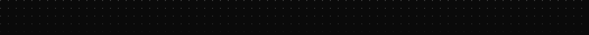
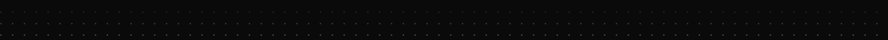

# rjsgud49

Gunhyoung Park

경북소프트웨어마이스터고등학교 3학년이고, 프론트엔드를 합니다. 
현재 (주)엠유트론 인턴입니다.

깊이 있게 문제를 탐구하며 사용자 경험을 끝까지 개선합니다. 
요구사항을 빠르게 구조화하고, 기능 단위로 결과를 도출합니다.

UX-focused frontend. React, TypeScript, realtime interfaces.

목표는 돈 잘벌고 행복한 프론트엔드 개발자입니다.

 

[포트폴리오](https://rjsgud.com) ·
[Velog](https://velog.io/@rjsgud49) ·
[Notion](https://rjsgud.notion.site/UX-32d39cf20212806e97bccb0b402094d4) ·
[qkrrjsgud49@gmail.com](mailto:qkrrjsgud49@gmail.com) ·
[LinkedIn](https://www.linkedin.com/in/%EA%B1%B4%ED%98%95-%EB%B0%95-6631b8320/) ·
[Discord](https://discord.gg/vZUxZJHKQp) ·
[Instagram](https://www.instagram.com/qkrrjsgud49/)

  

## 기술

프론트는 Next.js, React, TypeScript, Vite, Redux, Tailwind를 주로 씁니다. WebSocket, Socket.io, Recoil, Axios도 쓰고, Spring, Node, MySQL, Python, FastAPI, Docker, AWS도 다뤘습니다.

  
  
  
  
  
  
  
  
  

  
  
  
  
  
  
  
  
  

학습 중 — NestJS, Express. 
도구 — Figma, VS Code, IntelliJ IDEA, Git, GitHub, Notion, Ubuntu. Windows와 Illustrator도 씁니다.

## 패키지

### [react-maskify](https://www.npmjs.com/package/react-maskify)

React 19용 입력 마스크. `findDOMNode` 없는 react-input-mask 대안이고, 의존성 없이 TypeScript로 작성했습니다.

  
  

### [@mutron-ltd/mutron-ui](https://www.npmjs.com/package/@mutron-ltd/mutron-ui)

React UI 컴포넌트 라이브러리. 메인테이너로 있습니다.

  
  

## 오픈소스 기여

- [toss/react-simplikit #576](https://github.com/toss/react-simplikit/pull/576): `useLongPress`가 터치 후 발생하는 에뮬레이션 마우스 이벤트를 무시하도록 수정 (merged)
- [chakra-ui/zag #3523](https://github.com/chakra-ui/zag/pull/3523): tooltip이 disabled 해제 후 첫 hover에서 열리도록 수정 (merged)

## 기록

 

  

